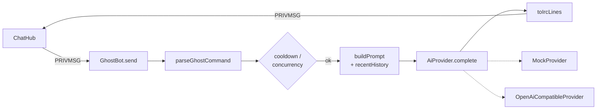

<!-- Draft written outside Kiro as a starting point; refine it in Kiro. -->
# Design: Ghost

## Overview
`GhostBot` (`src/ghost/ghost.ts`) implements the same `Client` interface as a
human connection. The hub delivers channel messages to it like to any member;
the bot sends replies back through `hub.handle()` as PRIVMSG/NOTICE, so TCP and
browser users see them identically.



## Interfaces
```ts
interface AiProvider {
  readonly name: string;
  complete(messages: ChatMessage[], opts: { task: "ask" | "summary" | "tldr" }): Promise<string>;
}
```
- `OpenAiCompatibleProvider`: `fetch` with `AbortSignal.timeout`, `max_tokens` from config, errors carry only the HTTP status.
- `MockProvider`: parses the transcript from the prompt and builds a deterministic reply (speaker counts, top words, last line).

## Decisions
- `run()` awaits `setImmediate` first so the reply is delivered and stored after the triggering line.
- Mentions require an explicit address (`Ghost:`, `Ghost,`, `@Ghost`). A bare "ghost" is common in Halloween chat and would cause noise.
- `!ask` questions get the last 10 lines as light context; the `!ask` prefix is removed from transcript lines.
- The system prompt tells the model that transcripts are untrusted user content.

## Testing strategy
- `test/ghost.test.ts`: command parsing, mention rules, line splitting, cooldown, NOTICE ignore, private messages, mock replies, provider error path.
- `test/e2e.test.ts`: Ghost answers `!ask` over TCP and `!summary` over WebSocket.
