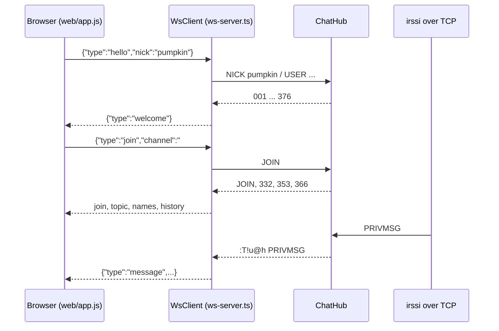

<!-- Draft written outside Kiro as a starting point; refine it in Kiro. -->
# Design: Web client and WebSocket bridge

## Overview

## Components
| Module | Responsibility |
|---|---|
| `web/bridge.ts` | `parseWsCommand` (size/shape checks), `wsCommandToIrc`, `IrcToWs` (stateful: collects 353→366 and 322→323) |
| `web/ws-server.ts` | Upgrade on `/ws` only, Origin allow-list, `WsClient` implementing `Client`, history replay, 30 s heartbeat |
| `web/http-server.ts` | Static files from `web/` with path-traversal guard, `/healthz`, `/api/info`, CSP and other security headers |
| `web/app.js` | Buffers per channel/query, slash commands, nick list, input history, localStorage for the last nick |
| `web/style.css` | Original CSS: CRT scanlines, green phosphor text, pumpkin-orange accents; system monospace fonts only |

## Decisions
- JSON instead of raw IRC in the browser: simpler UI code and a smaller attack surface; `raw` is still available for `/quote`.
- The browser's own messages are not echoed by IRC, so the client renders them locally on send.
- Host cloaks for web users use the first `X-Forwarded-For` hop (set by Caddy) and fall back to the socket address. They are hashed, so a spoofed header only changes the cloak.

## Testing strategy
- `test/bridge.test.ts`: command translation, validation, NAMES/LIST aggregation.
- `test/e2e.test.ts` and `npm run smoke`: real WebSocket and TCP clients exchanging messages.
