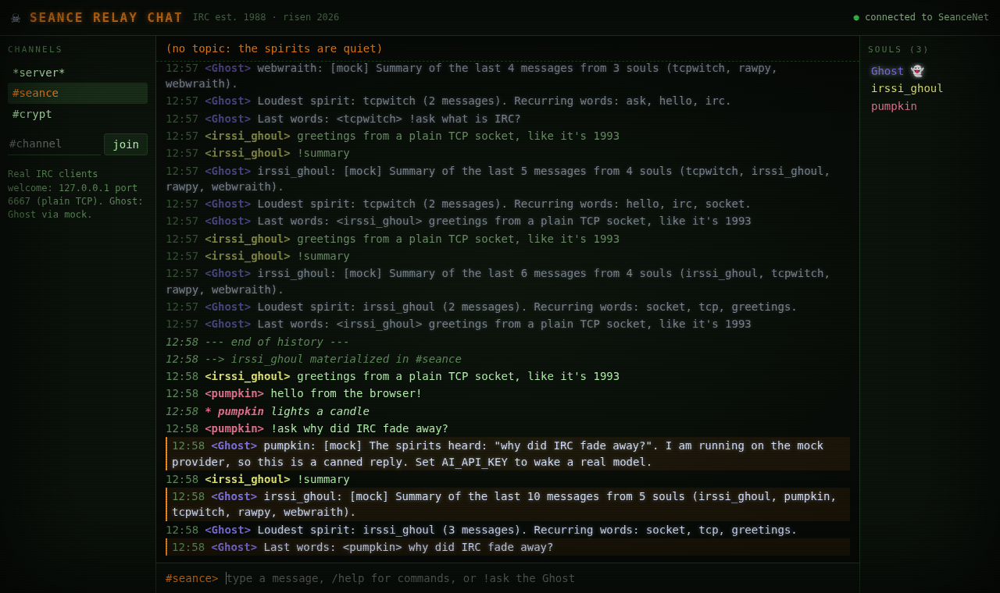
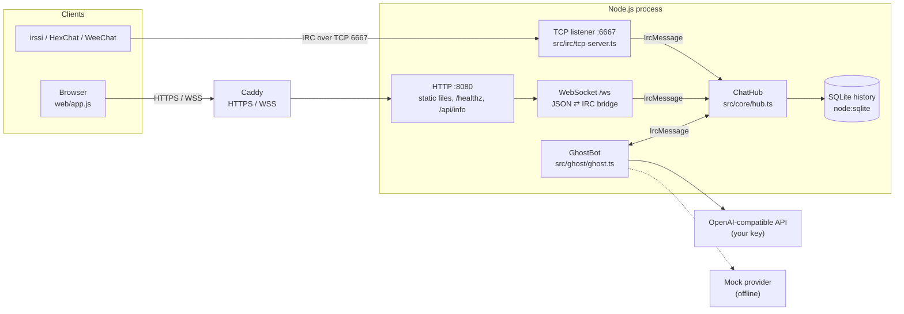

# Seance Relay Chat

**IRC, back from the grave — with a Ghost in the channel.**

Seance Relay Chat is a small, self-hostable chat server that speaks real IRC.
Connect with irssi, HexChat or WeeChat over plain TCP, or open the retro web
client in a browser — both land in the same channels. A resident AI bot,
**Ghost**, answers questions and summarizes the conversation on request.

Built for **Kiroween 2026**, category **Resurrection** — *"Bring your favorite
dead technology back to life."*



---

## Why IRC?

- **Internet Relay Chat** was written by Jarkko Oikarinen at the University of
  Oulu, Finland, in August 1988.
- The protocol was documented as **RFC 1459** in May 1993 and later updated by
  **RFC 2810–2813** in April 2000.
- For decades it was where open-source projects, hobbyists and whole communities
  lived. Most of that moved to closed, account-based chat apps.
- The protocol itself is still beautifully simple: a line of text over a TCP
  socket. You can speak it by hand. That makes it a perfect thing to resurrect.

This project keeps the protocol real (so 30-year-old clients still work) and adds
two modern things around it: a browser client and an AI participant.

## Features

- **Real IRC server** (RFC 1459 / RFC 2812 basics) on TCP 6667:
  `NICK`, `USER`, `JOIN`, `PART`, `PRIVMSG`, `NOTICE`, `PING`/`PONG`, `TOPIC`,
  `NAMES`, `QUIT`, plus `LIST`, `WHO`, `MODE` (read-only), `MOTD`, and `CAP LS`
  (empty) so modern clients register cleanly.
- **Web client** over WebSocket, bridged into the same hub as TCP users.
  Slash commands (`/join`, `/me`, `/msg`, `/nick`, `/topic`, `/list`, `/quote` …),
  per-channel buffers, nick list, history recovered on join.
- **Ghost, the AI bot** — a normal IRC user that responds to:
  - `!ask <question>` — answer in the channel
  - `!summary [n]` — summarize the last *n* lines (default 50, max 200)
  - `!tldr` — one-line summary
  - `Ghost: …`, `Ghost, …` or `@Ghost …` — mention it
  - private messages to `Ghost`
  - `!help`
- **Any OpenAI-compatible API** via env vars, or the built-in **mock provider**
  so everything works offline with no key.
- **SQLite history** (Node's built-in `node:sqlite`, no native addon).
- **Guard rails**: 512-byte IRC lines, flood throttling, per-nick AI cooldown and
  concurrency cap, cloaked hosts (no real IPs shown), CSP headers, `textContent`
  rendering only, WebSocket Origin allow-list.
- **Retro spooky UI**: green phosphor, scanlines, pumpkin-orange accents. Original
  CSS, system monospace fonts only, no images except an original SVG favicon,
  no music.

> **Bring your own official API keys; not a proxy for consumer subscriptions.**
> Ghost calls an API endpoint you configure with your own key. This project does
> not proxy, share or reuse Kiro or any other consumer subscription account.

## Architecture



Every connection type — TCP, WebSocket and the Ghost itself — implements the
same `Client` interface and talks to `ChatHub` in parsed IRC messages, so a
browser user and an irssi user see exactly the same channel.

## Quick start

Requirements: **Node.js 22.13+** (developed on Node 24).

```sh
npm install
npm run build
npm start            # IRC on :6667, web on http://localhost:8080
```

Or run from source: `npm run dev`.

Open <http://localhost:8080>, pick a nickname, and type `!ask is IRC dead?`.
With no API key, Ghost uses the mock provider and replies with `[mock] …`.

To use a real model:

```sh
cp .env.example .env
# set AI_PROVIDER=openai, AI_API_KEY, AI_MODEL (and AI_BASE_URL for non-OpenAI endpoints)
node --env-file=.env dist/index.js
```

### Docker

```sh
cp .env.example .env     # edit it
docker compose up -d --build
```

## Connect with a real IRC client

**irssi**
```
/connect localhost 6667
/join #seance
!ask what year was IRC created?
```

**HexChat**: *Network List → Add* → server `localhost/6667`, uncheck
*Use SSL for all the servers on this network*, connect, `/join #seance`.

**By hand** (it really is just text):
```
$ telnet localhost 6667
NICK ghosthunter
USER ghosthunter 0 * :Ghost Hunter
JOIN #seance
PRIVMSG #seance :!ask hello?
```

## Configuration

All settings are environment variables (see [`.env.example`](.env.example)).

| Variable | Default | Description |
|---|---|---|
| `IRC_HOST` / `IRC_PORT` | `0.0.0.0` / `6667` | IRC TCP listener |
| `HTTP_HOST` / `HTTP_PORT` | `0.0.0.0` / `8080` | Web client + WebSocket (`/ws`) |
| `SERVER_NAME` | `seance.local` | Server name in IRC prefixes |
| `NETWORK_NAME` | `SeanceNet` | Network name (005 `NETWORK=`) |
| `PUBLIC_IRC_HOST` | *(empty)* | Host shown in the web UI for IRC clients |
| `DEFAULT_CHANNELS` | `#seance,#crypt` | Always-open channels Ghost joins |
| `MOTD` | built-in | Comma-separated MOTD lines |
| `DB_PATH` | `./data/seance.db` | SQLite file |
| `HISTORY_ON_JOIN` | `50` | Lines replayed to web users on join |
| `HISTORY_RETENTION_DAYS` | `30` | Delete older history at startup (0 = keep) |
| `CLOAK_SALT` | random per start | Salt for host cloaks |
| `ALLOWED_ORIGINS` | *(empty = all)* | Comma-separated Origin allow-list for `/ws` |
| `GHOST_ENABLED` | `true` | Turn the bot off with `false` |
| `GHOST_NICK` | `Ghost` | Bot nickname |
| `GHOST_COOLDOWN_MS` | `5000` | Per-nick cooldown |
| `GHOST_MAX_LINES` | `5` | Max IRC lines per reply |
| `GHOST_SUMMARY_DEFAULT` / `GHOST_SUMMARY_MAX` | `50` / `200` | `!summary` window |
| `GHOST_MAX_CONCURRENT` | `3` | Parallel AI calls |
| `AI_PROVIDER` | `openai` if a key is set, else `mock` | `mock` or `openai` |
| `AI_BASE_URL` | `https://api.openai.com/v1` | Any OpenAI-compatible base URL |
| `AI_API_KEY` | *(empty)* | Your own official API key |
| `AI_MODEL` | `gpt-4o-mini` | Model name |
| `AI_TIMEOUT_MS` | `30000` | Request timeout |
| `AI_MAX_TOKENS` | `400` | `max_tokens` per reply |

## Deploy (self-hosted VPS)

`docker-compose.yml` runs the app plus **Caddy**, which gets a TLS certificate
automatically and proxies HTTPS and WSS to the app. IRC clients connect directly
to TCP **6667**, which you must open in the firewall (plus 80 and 443 for Caddy).

```sh
cp .env.example .env        # set DOMAIN, SERVER_NAME, PUBLIC_IRC_HOST, ALLOWED_ORIGINS, CLOAK_SALT
docker compose up -d --build
```

Full steps: [docs/deploy.md](docs/deploy.md).

## Development

```sh
npm test             # unit + end-to-end tests (ephemeral ports, in-memory SQLite)
npm run typecheck    # src, tests and scripts
npm run smoke -- 127.0.0.1 6667 8080   # live check against a running server
```

```
src/irc      line protocol, numerics, TCP server
src/core     ChatHub (transport-independent IRC logic), host cloaks
src/web      WebSocket bridge, HTTP server
src/ghost    Ghost bot and AI providers (OpenAI-compatible + mock)
src/store    SQLite history
web/         browser client (HTML, CSS, one ES module)
test/        node:test suites
.kiro/       steering, specs, hooks
```

## How Kiro was used

> **TODO (author):** write this section from real experience — which specs were
> generated or refined in Kiro, which hooks actually ran, how steering was used,
> what went well and what did not. Do not add claims or numbers that did not happen.

Note on the `.kiro/` folder: the steering files, the three specs
(`irc-core`, `web-client`, `ai-ghost`) and the hooks in this repository were
**drafted outside Kiro** as a starting point, following Kiro's documented
formats, so they can be opened, refined and executed in Kiro. The agent hook
`protocol-review-on-save.json` is disabled by default because agent hooks use
credits.

## Third-party software and licenses

| Component | License | Use |
|---|---|---|
| [ws](https://github.com/websockets/ws) | MIT | WebSocket server (runtime) |
| [TypeScript](https://www.typescriptlang.org/) | Apache-2.0 | Compiler (dev) |
| [tsx](https://github.com/privatenumber/tsx) | MIT | Run TS in dev/tests (dev) |
| `@types/node`, `@types/ws` | MIT | Type definitions (dev) |
| [Node.js](https://nodejs.org/) | MIT | Runtime (incl. `node:sqlite`) |
| [Caddy](https://caddyserver.com/) | Apache-2.0 | Reverse proxy image used in `docker-compose.yml` (not bundled) |

No third-party fonts, images, logos or audio are included. The UI uses the
system's monospace fonts; the favicon is an original SVG.

## Pre-existing code

None. All code in this repository was written for this hackathon entry,
starting on 2026-11-01. No templates or earlier projects were reused.

## License

[MIT](LICENSE) © 2026 Zhichao Duan
